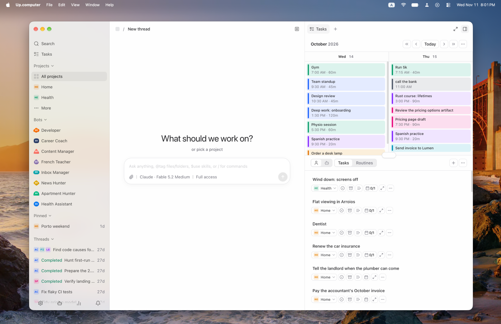
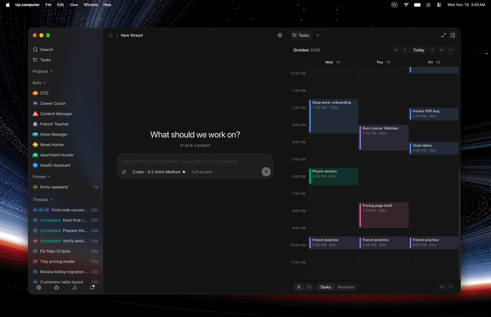
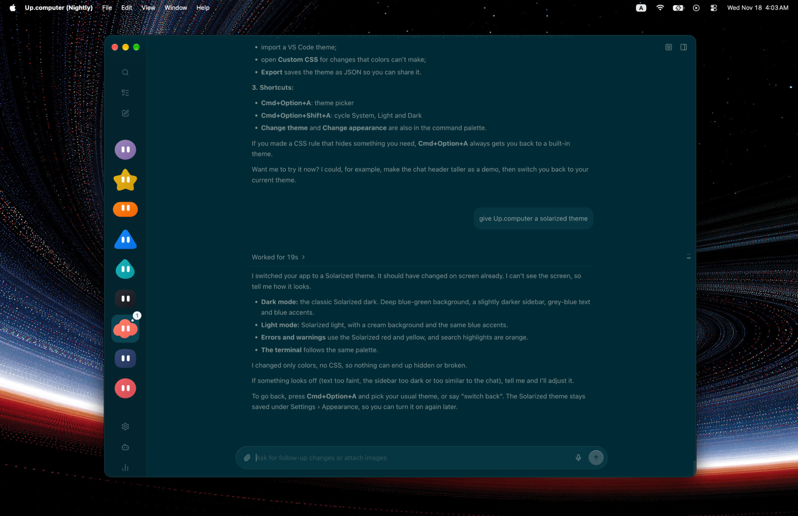

# Up.computer

[](https://github.com/krl-gr/upcomputer/releases/latest)
[](https://github.com/krl-gr/upcomputer/releases)
[](./LICENSE)

One desktop app for Claude Code, Codex and other coding agents. Chat, turn ideas into tasks, and let
workers do them in the background. Free, open source, and runs on your own subscriptions.



<p>
  
  
</p>

[Website](https://up.computer) · [Download](https://up.computer/download/) ·
[Blog](https://up.computer/blog/) · [Docs](./docs/README.md) ·
[Getting started](./docs/user/getting-started.md) · [FAQ](./docs/user/faq.md)

## Why Up.computer

- **Your agents in one place.** Claude Code, Codex, Cursor, OpenCode and more run side by side.
  Pick the agent and model for each chat, and switch between them from one sidebar.
- **Work that runs in the background.** Say what you want done in a chat. It becomes a task, and a
  worker picks it up while you keep talking. Workers can hand off to each other, for example one
  writes the code and another reviews it.
- **Bots that remember.** Turn a chat into a bot: one permanent chat with its own memory. It answers
  you and passes bigger jobs to workers.
- **Your chats stay on your computer.** Threads, tasks and settings live on your machine. Your code
  and prompts go straight to your agent's provider, not to us.

## Install

Download the app from [up.computer/download](https://up.computer/download/) or the
[latest release](https://github.com/krl-gr/upcomputer/releases/latest). There are builds for macOS
(Apple Silicon and Intel), Windows and Linux. The macOS builds are signed and notarized. The
Windows installer is not signed yet, so SmartScreen warns you on first launch: select
**More info**, then **Run anyway**. The app updates itself from GitHub releases.

**No subscription needed to start.** If no agent is set up on your computer, the desktop app
installs OpenCode on first launch and uses a free OpenCode Zen model, with no account. If you
already use Claude Code or Codex and are signed in, the app uses that instead. See
[First launch](./docs/user/welcome-wizard.md#first-launch-of-the-desktop-app).

To use your own agents, set up the ones you want:

- Codex: connect with ChatGPT in **Settings → Providers**, or install the
  [Codex CLI](https://developers.openai.com/codex/cli) and run `codex login`.
- Claude Code: install [Claude Code](https://claude.com/product/claude-code) and run
  `claude auth login`.
- Cursor: sign in from **Settings → Providers → Cursor**, or set `CURSOR_API_KEY`. No Cursor CLI
  is needed.
- Grok Build: install the [Grok Build CLI](https://x.ai/cli) and run `grok login`.
- OpenCode: install [OpenCode](https://opencode.ai) and run `opencode auth login`.
- Antigravity: install it and sign in with Google from its provider settings. No CLI is needed.
- Pi, Kiro, Muse Code and fx: see the [provider setup table](./docs/user/install.md#providers).
- Other agents: choose **Add provider** in **Settings → Providers** to add an agent from the
  [ACP Registry](https://agentclientprotocol.com/get-started/registry) or a local ACP command.

Codex and Claude are on by default. Turn the others on in **Settings → Providers**.

Homebrew, winget and AUR are not official install paths yet.

## What It Does

- **Chats.** Run any of your agents in project threads, with diffs of what changed. Commit, push
  and publish repositories from the app.
- **Tasks and workers.** Tasks have a title, a status and tags. A worker is a saved setup (agent,
  model, instructions) that picks up tasks by status and tag. Ask in any chat and the agent creates
  the task and the worker for you.
- **Automations.** Create tasks on a schedule, so workers start on their own.
- **Bots.** A permanent chat with long-lived memory that can do work itself or hand it to workers.
- **The planner.** Your own tasks and routines, next to the workers' tasks.
- **Computer use.** Agents get a managed browser and can see and control the desktop.
- **Remote access.** Reach your computer from another computer or a browser with UpComputer
  Connect, your local network or Tailscale. See [Remote access](./docs/user/remote-access.md).

Up.computer sends basic product usage events, never prompts, replies or file contents. See
[Product usage data](./docs/user/telemetry.md) to turn them off.

## Feedback

Found a bug or have an idea? Open an [issue on GitHub](https://github.com/krl-gr/upcomputer/issues).
Large feature work should start with an issue before a pull request.

## Run From Source

Requirements: Vite+ (`vp`), Node 24.13.1 or newer, Git, and at least one coding agent installed and
signed in.

```bash
curl -fsSL https://vite.plus | bash   # install Vite+
vp install
vp run dev
```

Other development commands: `vp run dev:web`, `vp run dev:server`, `vp run dev:desktop` and
`vp run dev:marketing`. See the [development runbook](./docs/operations/development.md) for
worktrees, ports and test data.

## Repository Layout

- `apps/desktop`: Electron desktop shell and release integration.
- `apps/server`: Node.js server that runs agent sessions and serves the web app.
- `apps/web`: React/Vite app for the main product UI.
- `apps/marketing`: Astro marketing and download site.
- `packages/contracts`: Shared Effect Schema contracts for provider events, the WebSocket
  protocol, settings and sessions.
- `packages/shared`: Runtime utilities shared by server and clients.
- `packages/client-runtime`: Client code shared by web and mobile.
- `packages/effect-acp` and `packages/effect-codex-app-server`: Agent protocol clients.
- `packages/provider-*`: Provider adapters.
- `packages/source-control-*`: Git hosting integrations.
- `packages/ssh` and `packages/tailscale`: Remote environment support.
- `packages/tasks-*`: Tasks, workers, bots, the planner and automations.
- `packages/computer-use-*`: Browser automation and computer use.
- `docs`: User and operations docs.

Not shipped by Up.computer yet:

- `apps/mobile`: React Native client from upstream.
- `infra/relay`: Connect relay from upstream.

## Relationship To T3 Code

Up.computer is a fork of the open-source [T3 Code](https://github.com/pingdotgg/t3code). It keeps
upstream's runtime, provider orchestration, contracts and desktop plumbing close to upstream, and
builds its own product, UI and workflow layer on top.

Internal names stay T3 Code's so upstream merges stay cheap: the `@t3tools/*` package scope,
`T3CODE_*` environment variables, the `t3` CLI name and the pairing protocol. The app identity,
protocol links, updates and data folders use Up.computer names. See
[docs/branding.md](./docs/branding.md).

## Contributing

The project is early and the architecture is still settling. Small, focused bug fixes,
reliability and performance improvements, and clear docs fixes are the easiest to review. For a
larger product, UI or architecture change, open an issue first. Read
[CONTRIBUTING.md](./CONTRIBUTING.md) before opening a pull request.

## Security

Do not report security problems in public issues. Email **support@up.computer** instead.

## License And Brand

The source code is MIT licensed. See [LICENSE](./LICENSE). Release builds also bundle third-party
components under their own licenses, listed in the app under
**Settings → General → Open source licenses**.

The MIT license does not grant rights to the Up.computer name, logo or visual identity. You may use
the name to refer to this project, but not in a way that suggests endorsement or an official build
without permission.

Licensing, privacy, security or support questions: **support@up.computer**.
